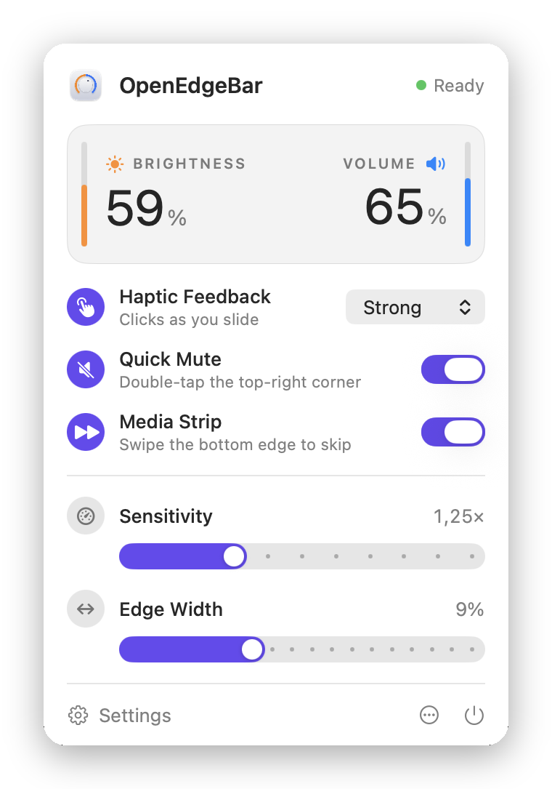
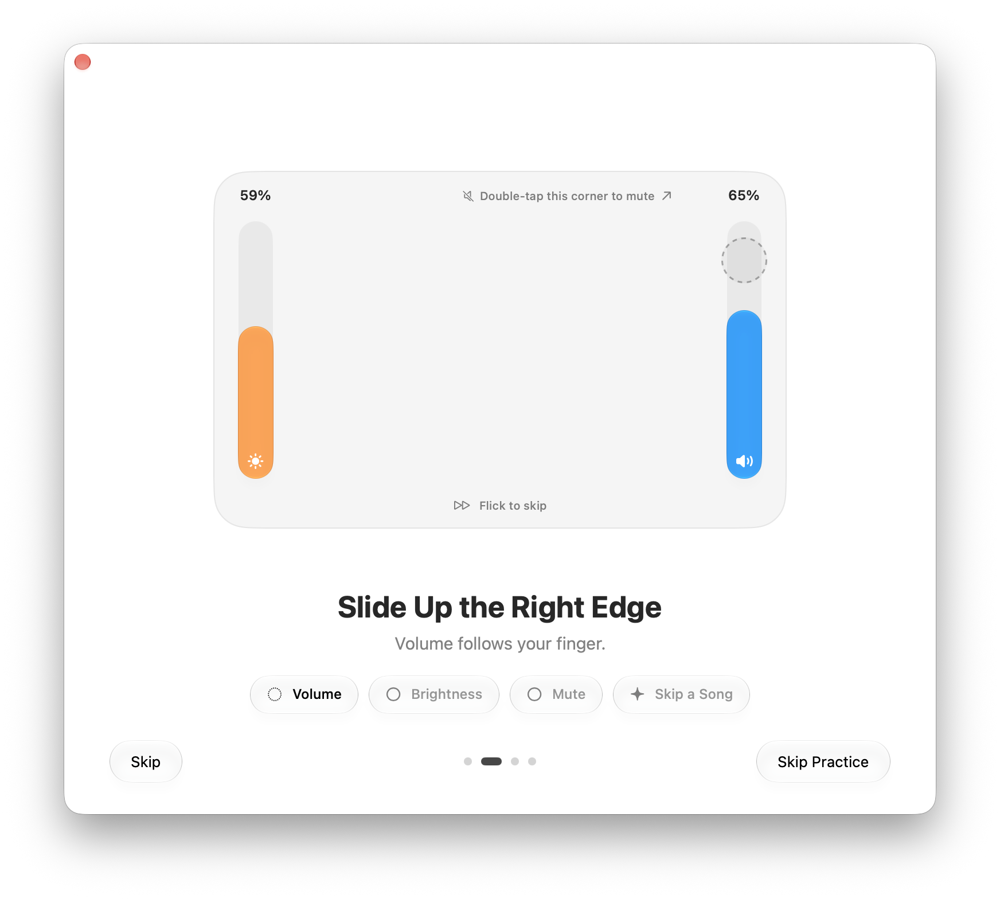

# OpenEdgeBar

Slide the edges of your MacBook trackpad to change brightness and volume. An open-source take on [EdgeBar](https://edgebar.xyz).

<p align="center">
  <picture>
    <source media="(prefers-color-scheme: dark)" srcset="docs/menu-dark.png">
    
  </picture>
</p>

- **Brightness on the left, volume on the right.** Slide a finger up or down the edge. You get the same on-screen display as the keyboard keys.
- **Quick Mute.** Double-tap the top-right corner.
- **Media Strip.** Flick a finger along the bottom edge to skip tracks. Tapping it to play or pause is optional and off by default, so clicks near the edge don't pause your music.
- **Haptic feedback.** A light tick under your finger for each step, mute and skip: Light, Medium or Strong.
- **Fine control.** Hold Shift-Option for quarter steps.
- **Cursor freeze.** The pointer stays put while you slide.
- **Your way.** Swap sides, only respond in the bottom quarter, require Fn or Option, sensitivity, edge width, light or dark appearance, open at login.
- **Menu bar only.** No Dock icon, and no CPU use while you're not touching the edges.

Requires macOS 14 Sonoma or later and a trackpad (built-in or Magic Trackpad). The welcome tour uses Liquid Glass on macOS 26 Tahoe and later, and a frosted look on earlier versions.

## Install

1. Download the DMG from the [latest release](https://github.com/ilyassesalama/OpenEdgeBar/releases/latest).
2. Open it and drag **OpenEdgeBar** onto **Applications**.
3. Open OpenEdgeBar. It is not notarized by Apple, so macOS blocks it the first time: allow it under **System Settings › Privacy & Security › Open Anyway**.

To update, install a newer release the same way. macOS asks for **Open Anyway** once per version.

## Build and run

You need Xcode and [XcodeGen](https://github.com/yonaskolb/XcodeGen) (`brew install xcodegen`).

```bash
./scripts/build.sh
```

This builds `build/OpenEdgeBar.app`. To install it to /Applications and open it:

```bash
./scripts/build.sh --install
```

To work in Xcode, run `xcodegen generate` and open `OpenEdgeBar.xcodeproj`.

The app icon is a Liquid Glass icon in `App/AppIcon.icon`. Edit it in Icon Composer, which comes with Xcode. Xcode also builds a flat version from it for macOS 14 and 15.

### Signing

macOS remembers the Accessibility permission per code signature. An unsigned (ad-hoc) build gets a new signature every time, so you would have to allow it again after each rebuild. To avoid that, copy `Config/Local.example.xcconfig` to `Config/Local.xcconfig` and set your Apple Developer team ID.

## Permissions

OpenEdgeBar presses the brightness and volume keys for you, the same keys as on your keyboard. macOS asks you to allow that once, under **System Settings › Privacy & Security › Accessibility**. The welcome tour walks you through it on first launch.

## The welcome tour

The first launch opens a short tour in a native macOS window with Liquid Glass controls (frosted before macOS 26): a welcome, a step to allow the keys, a hands-on practice where your real fingers appear live on a picture of your trackpad and each gesture ticks off a challenge, a few options, and a finale. You can replay it from the menu (**… › Welcome Tour**) or skip it with Escape.

<p align="center">
  <picture>
    <source media="(prefers-color-scheme: dark)" srcset="docs/tour-dark.png">
    
  </picture>
</p>

Reading the trackpad needs no permission.

## How it works

| Module | What it does |
| --- | --- |
| `EdgeBarCore` | The gesture engine. Turns raw touch frames into actions: slide steps, mute, skip. Pure Swift, no AppKit. |
| `CMultitouch` | C declarations for Apple's private MultitouchSupport framework. |
| `EdgeBarSystem` | Talks to macOS: reads the trackpad, presses media keys, plays haptics on the trackpad's actuator, freezes the cursor, and reads and sets brightness and volume. |
| `EdgeBarUI` | The menu bar window, the settings and the welcome tour. |
| `App` | The app entry point that wires it all together. |

Some notes on the approach:

- Touches come from the private `MultitouchSupport` framework, opened at runtime with `dlopen`. This is how established trackpad utilities work; there is no public API for raw touches outside your own window.
- Steps are sent as real media key presses, so macOS shows its own on-screen display and quarter steps work natively with Shift-Option. If an app such as BetterDisplay or MonitorControl handles your brightness keys, it handles OpenEdgeBar's steps too, exactly as it does for the keyboard.
- Haptics use the trackpad's actuator directly. The public `NSHapticFeedbackManager` has only one fixed strength.
- The pointer is frozen by disconnecting it from mouse movement for the length of the slide, so no event tap is needed.

## Releasing

Pushing a version tag publishes a release:

```bash
git tag v1.1.0 && git push origin v1.1.0
```

The [release workflow](.github/workflows/release.yml) builds and signs the app on GitHub and uploads it as a DMG to a GitHub release.

### Signing and secrets

Every release is signed with the same self-signed certificate, `OpenEdgeBar Release`. A matching signature is what lets the Accessibility permission survive updates, so keep the certificate and never replace it. It lives in the maintainer's login keychain, valid until 2036. Back it up: in **Keychain Access**, under **My Certificates**, right-click it and choose **Export**.

The release workflow uses two repository secrets:

- `SIGNING_CERTIFICATE`: the certificate and its private key, as a base64 `.p12` file.
- `SIGNING_CERTIFICATE_PASSWORD`: the password of that file.

## Troubleshooting

- **The menu bar icon is missing.** On MacBooks with a notch, menu bar icons that don't fit are hidden behind it. Hold Command and drag other icons out of the way, or quit apps you don't need in the menu bar.
- **Edges stopped working after a rebuild.** The build's signature changed. Remove OpenEdgeBar from the Accessibility list with the minus button, then allow it again. See [Signing](#signing).
- **Brightness steps look different from volume steps.** Another app is probably handling your brightness keys. That's expected: OpenEdgeBar behaves exactly like your keyboard.

## License

MIT. See [LICENSE](LICENSE).
